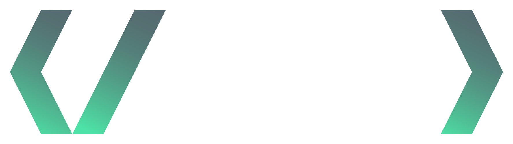

<!-- GEN:intro:START -->
<a href="https://vwesley.dev"><picture><source media="(prefers-color-scheme: dark)" srcset="assets/intro-dark.svg?v=c4d52978"><source media="(prefers-color-scheme: light)" srcset="assets/intro-light.svg?v=1f71f3bd"></picture></a>
<!-- GEN:intro:END -->

<a href="https://vwesley.dev">Website</a>&nbsp;· <a href="https://vwesley.dev/professional/projects/">Projects</a>&nbsp;· <a href="https://vwesley.dev/professional/experience/">Experience</a>&nbsp;· <a href="https://vwesley.dev/professional/resume/">Résumé</a>&nbsp;· <a href="https://vwesley.dev/#contact">Contact</a>&nbsp;· <a href="https://devpulse.vwesley.workers.dev">Project health</a>

I build web apps, data tools and real-time browser graphics, mostly with TypeScript, WebGL and Cloudflare. I run **Vin’s Atelier**, my one-person studio: everything below is designed, built and kept running by me.

<!-- GEN:now:START -->
**Now:** working on [DevPulse](https://devpulse.vwesley.workers.dev/), a live status board for all my projects.
<!-- GEN:now:END -->

### Things I’ve built

<!-- GEN:built:START -->

<a href="https://vincentwesley.github.io/black-hole/"><picture><source media="(prefers-color-scheme: dark)" srcset="assets/tiles/black-hole-dark.svg?v=611f2248"><source media="(prefers-color-scheme: light)" srcset="assets/tiles/black-hole-light.svg?v=ff391b97"></picture></a> <a href="https://vincentwesley.github.io/sdf-forge/"><picture><source media="(prefers-color-scheme: dark)" srcset="assets/tiles/sdf-forge-dark.svg?v=cef68ed6"><source media="(prefers-color-scheme: light)" srcset="assets/tiles/sdf-forge-light.svg?v=9c3d40bf"></picture></a>

<a href="https://metalensvgc.pages.dev/"><picture><source media="(prefers-color-scheme: dark)" srcset="assets/tiles/MetaLensVGC-dark.svg?v=69e5ea71"><source media="(prefers-color-scheme: light)" srcset="assets/tiles/MetaLensVGC-light.svg?v=2ddb165e"></picture></a> <a href="https://vincentwesley.github.io/safe-regex/"><picture><source media="(prefers-color-scheme: dark)" srcset="assets/tiles/safe-regex-dark.svg?v=a8595b8b"><source media="(prefers-color-scheme: light)" srcset="assets/tiles/safe-regex-light.svg?v=f18e3668"></picture></a>

<a href="https://vincentwesley.github.io/glass-compiler/"><picture><source media="(prefers-color-scheme: dark)" srcset="assets/tiles/glass-compiler-dark.svg?v=8e6346f4"><source media="(prefers-color-scheme: light)" srcset="assets/tiles/glass-compiler-light.svg?v=5243fed0"></picture></a> <a href="https://vincentwesley.github.io/sg-time-machine/"><picture><source media="(prefers-color-scheme: dark)" srcset="assets/tiles/sg-time-machine-dark.svg?v=303235ab"><source media="(prefers-color-scheme: light)" srcset="assets/tiles/sg-time-machine-light.svg?v=5ca2a5b8"></picture></a>

<!-- GEN:built:END -->

<!-- GEN:also:START -->
Also: [Synthwave Drive](https://vincentwesley.github.io/synthwave-drive/) · [Koi Pond](https://vincentwesley.github.io/koi-pond/) · [LLM Microscope](https://github.com/vincentwesley/llm-microscope) · [DevPulse](https://devpulse.vwesley.workers.dev/) · [TL;DR Panel](https://github.com/vincentwesley/tldr-panel) · [Clearslip](https://github.com/vincentwesley/clearslip)
<!-- GEN:also:END -->

 

<a href="https://vwesley.dev"><picture><source media="(prefers-color-scheme: dark)" srcset="assets/brand/atelier-b.svg"><source media="(prefers-color-scheme: light)" srcset="assets/brand/atelier-a.svg"></picture></a>

MetaLens VGC is a fan project, not affiliated with Nintendo, Game Freak or The Pokémon Company. Logo by Portus Workstation (<a href="https://www.instagram.com/portus_workstation/">@portus_workstation</a> / <a href="https://www.instagram.com/wason25_pz/">@wason25_pz</a>), all rights reserved, see <a href="NOTICE.md">NOTICE.md</a>. Copyright 2026 Vin’s Atelier. Designed and built by Vin. Code <a href="LICENSE">MIT</a>, provided as is.

